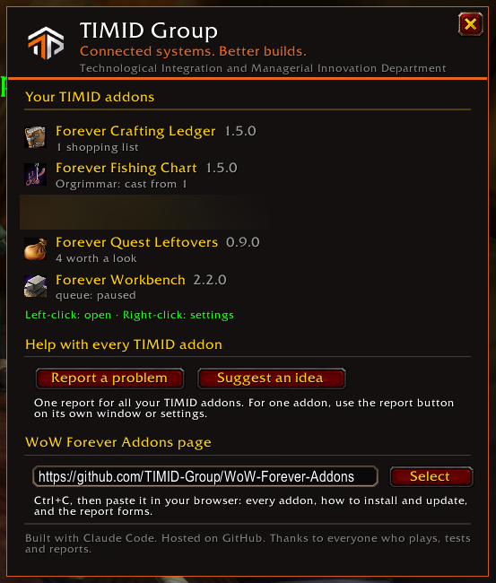

<div align="center">

<a href="https://github.com/TIMID-Group"></a>

# 🧩 WoW Forever Addons

<sub>by [TIMID Group](https://github.com/TIMID-Group) · connected systems. better builds.</sub>

**Small, focused addons for WoW Forever:** shopping lists, professions, crafting, fishing, quests, levelling and exploring.

[Addons](#-the-addons) · [Install](#-install) · [Let an AI do it](#3-let-an-ai-agent-do-it) · [Updating](#-updating) · [Troubleshooting](#-troubleshooting) · [Bugs and ideas](#-bugs-and-ideas) · [Reports](#-reports) · [FAQ](#-faq)

</div>

> [!TIP]
> **📣 New: Deep chains: Forever Workbench 2.5 and Forever Crafting Ledger 1.9.** [Read the announcement, with screenshots](https://github.com/TIMID-Group/WoW-Forever-Addons/discussions/71).

> [!NOTE]
> **The addons are invite only.** Each addon is a private repo and access is per addon: the ones you were given open normally, the rest show a 404 until you're invited. **Want one?** [Request access](https://github.com/TIMID-Group/WoW-Forever-Addons/issues/new?template=request_access.yml): tick the addons and submit. **Reports:** a problem or an idea about one addon goes to that addon's own page (the report button in the game takes you there). For TIMID as a whole, or several addons at once, anyone can [report a problem](https://github.com/TIMID-Group/WoW-Forever-Addons/issues/new?template=bug_report.yml&addon=TIMID%20Group) or [suggest an idea](https://github.com/TIMID-Group/WoW-Forever-Addons/issues/new?template=feature_request.yml&addon=TIMID%20Group) here, invited or not. This page is public, so requests and reports here can be read by anyone; an access request is removed once it's answered.

## 📚 The addons

| | Addon | What it does | Latest | Command | Access |
| --- | --- | --- | --- | --- | --- |
| 🛠️ | **[Forever Apprentice](addons/ForeverApprentice.md)** | Levels a profession step by step: the route from the Forever guides, the costs, and one click to Workbench and your shopping list. | [0.1.0](https://github.com/TIMID-Group/ForeverApprentice/releases/latest) | `/apprentice` | 🔒 invite only ([request](https://github.com/TIMID-Group/WoW-Forever-Addons/issues/new?template=request_access.yml)) |
| 🛠️ | **[Forever Crafting Ledger](addons/ForeverCraftingLedger.md)** | What every recipe of every profession earns: each material from your cheapest vendor or the auction house, the product sold to a vendor or auctioned. Named shopping lists with your own prices. Reads Auctionator's prices. | [1.12.0](https://github.com/TIMID-Group/ForeverCraftingLedger/releases/latest) | `/fcl` | 🔒 invite only ([request](https://github.com/TIMID-Group/WoW-Forever-Addons/issues/new?template=request_access.yml)) |
| 📜 | **[Forever Ding](addons/ForeverDing.md)** | Will the quests you can hand in level you up? Forever Ding adds up their XP, in your zone and across the world, and shows the level you would reach. | [1.1.3](https://github.com/TIMID-Group/ForeverDing/releases/latest) | `/ding` | 🔒 invite only ([request](https://github.com/TIMID-Group/WoW-Forever-Addons/issues/new?template=request_access.yml)) |
| 🛠️ | **[Forever Fishing Chart](addons/ForeverFishingChart.md)** | Fishing waters on the world map: catches, skill checks and time-of-day rates, plus a fish finder and your own catch log. | [1.7.3](https://github.com/TIMID-Group/ForeverFishingChart/releases/latest) | `/ffc` | 🔒 invite only ([request](https://github.com/TIMID-Group/WoW-Forever-Addons/issues/new?template=request_access.yml)) |
| 📜 | **[Forever Quest Leftovers](addons/ForeverQuestLeftovers.md)** | Looks through your bags and bank for items no quest needs any more, says why, and says what to do with each one. Dungeon keys, attunements and boss summons are listed as worth keeping. It only advises. | [0.12.0](https://github.com/TIMID-Group/ForeverQuestLeftovers/releases/latest) | `/leftovers` | 🔒 invite only ([request](https://github.com/TIMID-Group/WoW-Forever-Addons/issues/new?template=request_access.yml)) |
| 💰 | **[Forever Stocking Stuffer](addons/ForeverStockingStuffer.md)** | A simple auction house shopping list: put items on a list with a quantity and a max price, then click Buy next once per purchase, cheapest first. | [0.1.0](https://github.com/TIMID-Group/ForeverStockingStuffer/releases/latest) | `/stuffer` | 🔒 invite only ([request](https://github.com/TIMID-Group/WoW-Forever-Addons/issues/new?template=request_access.yml)) |
| 🗺️ | **[Forever Wanderer](addons/ForeverWanderer.md)** | Explore every place you have not discovered yet: one click on a Legacy Explore challenge makes the shortest journey through them. | [0.1.1](https://github.com/TIMID-Group/ForeverWanderer/releases/latest) | `/wanderer` | 🔒 invite only ([request](https://github.com/TIMID-Group/WoW-Forever-Addons/issues/new?template=request_access.yml)) |
| 🛠️ | **[Forever Workbench](addons/ForeverWorkbench.md)** | Makes the profession window richer. Shows materials on hand and items in bags on every recipe, buys the vendor materials for a recipe while leaving bag space to craft, sells what you crafted, and runs a crafting queue. | [2.8.0](https://github.com/TIMID-Group/ForeverWorkbench/releases/latest) | `/workbench` | 🔒 invite only ([request](https://github.com/TIMID-Group/WoW-Forever-Addons/issues/new?template=request_access.yml)) |

Click an addon's name for its page here: what it does, with pictures. Its own page (invite only) has the download, the commands and a full guide.

> [!NOTE]
> **🚪 Room 404.** Projects in development. If you can't find it, you weren't meant to.

## 📦 Install

All three use the same release zip, so you can mix them and switch any time.

| | 1. WowUp | 2. Manual | 3. AI agent |
| --- | --- | --- | --- |
| **Best for** | Set and forget | No extra software | You already use Claude Code |
| **Updates** | Automatic | Download again | Run the prompt again |
| **You need** | [WowUp](https://wowup.io) + a GitHub token | Nothing | Claude Code + the GitHub CLI |

First, **accept your invites**: one per addon, by email or from the banner on each addon's page. They expire after 7 days.

### 1. WowUp (recommended)

1. **Make a GitHub token** (once): [create one here](https://github.com/settings/tokens/new?scopes=repo&description=WowUp%20%28WoW%20Forever%20addons%29). It's pre-filled with the `repo` scope; choose an expiry and press *Generate token*.
   > **Use a classic token.** Fine-grained tokens can't see repos you were invited to as a collaborator, so WowUp would find nothing.
2. In WowUp: **Options → Addons → GitHub Personal Access Token**, paste it.
3. Pick your **WoW Forever** installation at the top (WowUp recognises the `_forever_` folder; if it's missing, add it under *Options → WoW Installations*).
4. **Get Addons → Install from URL**, paste an addon's link, install. Repeat for each:

```text
https://github.com/TIMID-Group/ForeverApprentice
https://github.com/TIMID-Group/ForeverCraftingLedger
https://github.com/TIMID-Group/ForeverDing
https://github.com/TIMID-Group/ForeverFishingChart
https://github.com/TIMID-Group/ForeverQuestLeftovers
https://github.com/TIMID-Group/ForeverStockingStuffer
https://github.com/TIMID-Group/ForeverWanderer
https://github.com/TIMID-Group/ForeverWorkbench
```

WowUp shows updates from then on.

### 2. Manual

1. On the addon's page, open **Latest release** and download `<Addon>-X.Y.Z-forever.zip` under *Assets* (not *Source code*).
2. Extract it into `World of Warcraft/_forever_/Interface/AddOns/`, giving `AddOns/<Addon>/<Addon>.toc`.
3. Restart the game. A new addon only shows after a restart; `/reload` doesn't find it.

### 3. Let an AI agent do it

> [!TIP]
> Paste this into **Claude Code** (or another coding agent that can run commands). It installs every addon you have access to; run it again later to update. It needs the [GitHub CLI](https://cli.github.com) logged in as you (`gh auth login`).

```text
Install or update my WoW Forever addons from GitHub: every addon repo I can access in the org (names starting with "Forever").

Context: the addons are private repos in the GitHub org TIMID-Group. Every release has an asset
named <Repo>-<version>-forever.zip that holds one top-level folder <Repo>/ with <Repo>.toc in it.
I can only see the repos I have been invited to.

1. Check the GitHub CLI is installed and logged in (`gh auth status`). If it isn't, stop and tell
   me how to set it up.
2. List the addon repos I can access: `gh repo list TIMID-Group --limit 100 --json name --jq '.[].name'` and keep the names starting with `Forever`.
3. Find my WoW Forever folder: `_forever_` inside my World of Warcraft install (Windows
   default: C:\Program Files (x86)\World of Warcraft\_forever_). If you can't find it, ask me.
   The target is `_forever_/Interface/AddOns/`.
4. For each addon: download the latest release's zip with
   `gh release download --repo TIMID-Group/<Repo> --pattern '*-forever.zip' --dir <a temp folder>`,
   check it contains `<Repo>/<Repo>.toc` at the top, delete the old `AddOns/<Repo>` folder if
   there is one, and extract the new folder in its place.
5. Never touch the `WTF` folder (my settings and history live there) or any other addon.
6. Finish with a table: addon, installed version (the `## Version` line in the .toc), and
   whether it was new, updated or already current. Remind me to restart the game: a new
   addon only shows after a restart, not a /reload.
```

## 🧭 The TIMID button

With **two or more** TIMID addons installed, their minimap buttons fold into **one TIMID Group button**, so your minimap stays clean however many you use. With just one, its own button shows as always.

| Do this | To |
| --- | --- |
| **Left-click** the TIMID button | open the TIMID panel beside it: a row per TIMID addon with its icon, name and a live status line |
| **Click** "TIMID Group" at the top of the panel | open the TIMID Group window (below) |
| **Left-click** a row in the panel | open that addon, as its own button does |
| **Right-click** a row in the panel | open its settings |
| **Hover** a row in the panel | see its usual tooltip |
| **Drag** the TIMID button | move it (one spot for all of them, remembered) |
| Click the TIMID button again, click anywhere else, press **Escape**, or move the mouse away | close the panel |

Each row's status line says what that addon is doing now, for example the crafting queue's step in Workbench, your zone's fishing skill in Fishing Chart, or how many items look left over in Quest Leftovers.

> [!TIP]
> Rather have every button on its own? Untick **Group the TIMID addons' buttons into one** (under *TIMID minimap button* on the Housekeeping page of any TIMID addon's settings), right-click the TIMID button twice, or type `/timid separate` (`/timid group` brings the TIMID button back). It is remembered for all of them.

### The TIMID Group window

Click **TIMID Group** at the top of the TIMID panel, or type **`/timid`**, for one window about all of them:

- every TIMID addon you have, with its version and what it is doing now (left-click a row to open that addon, right-click for its settings);
- **Report a problem** and **Suggest an idea** for all of them at once, for something that isn't about one addon;
- the address of this page, and the credits.

<p align="center"></p>

With two or more TIMID addons, the game's **Settings** have one **TIMID Group** entry in the AddOns list, with each addon's settings under it. With just one, it keeps its own entry.

| Command | Does |
| --- | --- |
| `/timid` | open the TIMID Group window |
| `/timid report`, `/timid idea` | report a problem, or suggest an idea, for all the TIMID addons |
| `/timid settings` | open the TIMID Group settings |
| `/timid group`, `/timid separate` | one TIMID button, or every addon's own button |

## 🔄 Updating

| If you installed with | To update |
| --- | --- |
| WowUp | It shows the update; press *Update* (or *Update All*). |
| Manual | Delete the old folder, extract the new zip, restart the game. |
| AI agent | Run the same prompt again. |

Settings are never lost on update. To be emailed about new versions, open an addon's page and choose **Watch → Custom → Releases**.

## 🩺 Troubleshooting

<details>
<summary><b>An addon link shows 404</b></summary>

You're signed out, the invite isn't accepted yet, or you weren't invited to that addon. Ask for access.

</details>

<details>
<summary><b>WowUp says it can't find the addon or a valid release</b></summary>

Check the token is saved in *Options → Addons*, is a **classic** token with `repo`, and hasn't expired. Check you're on the *WoW Forever* installation, not Retail or Classic.

</details>

<details>
<summary><b>The addon isn't in the game's AddOns list</b></summary>

Restart the game first: a new addon only shows after a restart, not a `/reload`. Still missing? The folder is probably nested (`AddOns/ForeverWorkbench/ForeverWorkbench/...`). Move the inner folder up one level so the `.toc` sits directly inside `AddOns/<Addon>/`.

</details>

<details>
<summary><b>It says *out of date*</b></summary>

Tick **Load out of date AddOns** on the AddOns screen at character select.

</details>

<details>
<summary><b>I get a Lua error</b></summary>

Copy the full text (`/console scriptErrors 1` turns the pop-ups on), then press the addon's report button (**!**) or type its report command (`/wb report`, `/fcl report` and so on): the link opens that addon's own form. Paste the error there.

</details>

<details>
<summary><b>I want to reset an addon's settings</b></summary>

With the game closed, delete `WTF/Account/<account>/SavedVariables/<Addon>.lua`.

</details>

## 💬 Bugs and ideas

**About one addon:** report it on that addon's own page. Only people who have the addon can read it, and that is all it takes to report there.

| Addon | |
| --- | --- |
| Forever Apprentice | [Report a problem](https://github.com/TIMID-Group/ForeverApprentice/issues/new?template=bug_report.yml) · [Suggest an idea](https://github.com/TIMID-Group/ForeverApprentice/issues/new?template=feature_request.yml) |
| Forever Crafting Ledger | [Report a problem](https://github.com/TIMID-Group/ForeverCraftingLedger/issues/new?template=bug_report.yml) · [Suggest an idea](https://github.com/TIMID-Group/ForeverCraftingLedger/issues/new?template=feature_request.yml) |
| Forever Ding | [Report a problem](https://github.com/TIMID-Group/ForeverDing/issues/new?template=bug_report.yml) · [Suggest an idea](https://github.com/TIMID-Group/ForeverDing/issues/new?template=feature_request.yml) |
| Forever Fishing Chart | [Report a problem](https://github.com/TIMID-Group/ForeverFishingChart/issues/new?template=bug_report.yml) · [Suggest an idea](https://github.com/TIMID-Group/ForeverFishingChart/issues/new?template=feature_request.yml) |
| Forever Quest Leftovers | [Report a problem](https://github.com/TIMID-Group/ForeverQuestLeftovers/issues/new?template=bug_report.yml) · [Suggest an idea](https://github.com/TIMID-Group/ForeverQuestLeftovers/issues/new?template=feature_request.yml) |
| Forever Stocking Stuffer | [Report a problem](https://github.com/TIMID-Group/ForeverStockingStuffer/issues/new?template=bug_report.yml) · [Suggest an idea](https://github.com/TIMID-Group/ForeverStockingStuffer/issues/new?template=feature_request.yml) |
| Forever Wanderer | [Report a problem](https://github.com/TIMID-Group/ForeverWanderer/issues/new?template=bug_report.yml) · [Suggest an idea](https://github.com/TIMID-Group/ForeverWanderer/issues/new?template=feature_request.yml) |
| Forever Workbench | [Report a problem](https://github.com/TIMID-Group/ForeverWorkbench/issues/new?template=bug_report.yml) · [Suggest an idea](https://github.com/TIMID-Group/ForeverWorkbench/issues/new?template=feature_request.yml) |

**About TIMID as a whole** (the TIMID button and panel, the TIMID Group window, or several addons at once): [**report a problem**](https://github.com/TIMID-Group/WoW-Forever-Addons/issues/new?template=bug_report.yml&addon=TIMID%20Group) or [**suggest an idea**](https://github.com/TIMID-Group/WoW-Forever-Addons/issues/new?template=feature_request.yml&addon=TIMID%20Group) here, on this page, open to everyone, invited or not. Reports here are public; the report from the game holds nothing about your character, gold or account.

**From the game, the quick way:**

1. Press the small report button (**!**) beside the gear on the addon's window (right-click it for an idea), or **Report a problem** / **Suggest an idea** on any of its settings pages. The window stays open, and the link opens that addon's own form. Not about one addon? Use the same buttons in the TIMID Group window (`/timid`), or type `/timid report`: those come here.
2. A small box shows a link, already selected: press **Ctrl+C**, then paste it into your web browser.
3. The form opens with where you were and the details from the game (the version, your changed settings and any errors the addon caught) already filled in. Write what happened in the boxes above the details, paste a screenshot with **Ctrl+V** if it helps, and press Submit.

> [!TIP]
> No title needed: each report is labelled and titled automatically. If a link ever opens with an empty Details box, use **Full report** in that small box (or `/wb report`, `/fcl report` and so on, or `/timid report` for all of them) and paste the text it gives you there.

<!-- reports:start -->

## 🗂️ Reports

What has been reported and suggested, per addon: open first, then done. An addon's reports are on its own page, so its links open for people who have that addon. 🐞 a problem, 💡 an idea.

<details>
<summary><b>Apprentice</b> (0 open, 0 done)</summary>

Nothing reported yet.

[See all](https://github.com/TIMID-Group/ForeverApprentice/issues?q=is%3Aissue)

</details>

<details>
<summary><b>Crafting Ledger</b> (2 open, 18 done)</summary>

**Open**

- 🐞 [A confidential addon's name ships in the README, CHANGELOG, About.lua and tests](https://github.com/TIMID-Group/ForeverCraftingLedger/issues/6) · #6
- 💡 [What can I make from my bags? A list built from the random materials you collect while levelling](https://github.com/TIMID-Group/ForeverCraftingLedger/issues/2) · #2

**Done**

- 💡 [Queue it sends no Sell steps, so a group with tight bags pauses with "no room"](https://github.com/TIMID-Group/ForeverCraftingLedger/issues/11) · #11
- 💡 [Saved data: a version, caps and repair on load](https://github.com/TIMID-Group/ForeverCraftingLedger/issues/10) · #10
- 🐞 [Pull prices: a second pull overwrites the undo, so prices from before the first are lost](https://github.com/TIMID-Group/ForeverCraftingLedger/issues/9) · #9
- 🐞 [Send can change a list while it is being bought, or overwrite one without asking](https://github.com/TIMID-Group/ForeverCraftingLedger/issues/7) · #7
- 🐞 [Send to shopping list: the most to pay can mean buying at a loss](https://github.com/TIMID-Group/ForeverCraftingLedger/issues/4) · #4
- 🐞 [Bundled recipe data has Classic reagents for about 25 recipes WoW Forever changed](https://github.com/TIMID-Group/ForeverCraftingLedger/issues/13) · #13
- 💡 [Materials: a Craft sells for column (what one craft of the best recipe vendors for)](https://github.com/TIMID-Group/ForeverCraftingLedger/issues/12) · #12
- 🐞 [Measured craft times read from Workbench's saved data; the contract test loads Workbench by file name](https://github.com/TIMID-Group/ForeverCraftingLedger/issues/8) · #8
- 🐞 [Garbage and hitches in play: a per-frame watcher, uncached plans, nothing waits for combat](https://github.com/TIMID-Group/ForeverCraftingLedger/issues/5) · #5
- 💡 [Materials: a "Sells for" column, clearly marked unlearned recipes, and a Known / All recipes switch](https://github.com/TIMID-Group/ForeverCraftingLedger/issues/3) · #3
- 💡 [Sending a shopping list is one and done: remove the self-updating link](https://github.com/TIMID-Group/ForeverCraftingLedger/issues/1) · #1
- 💡 ["Plan for" setting per list (make everything / cheapest / best gold per hour / buy all I can)](https://github.com/TIMID-Group/WoW-Forever-Addons/issues/60) · #60
- 💡 [An overview of all lists as cards, and a clear way back](https://github.com/TIMID-Group/WoW-Forever-Addons/issues/59) · #59
- 💡 [Keep the \[classified\] list in step with the plan](https://github.com/TIMID-Group/WoW-Forever-Addons/issues/55) · #55
- 💡 [Plan an hour of crafting (how much to buy for one hour)](https://github.com/TIMID-Group/WoW-Forever-Addons/issues/45) · #45
- 💡 [The Materials tab's profit and Gold/hour columns read as selling the material itself](https://github.com/TIMID-Group/WoW-Forever-Addons/issues/44) · #44
- 💡 [Pull your \[classified\] prices into Your prices](https://github.com/TIMID-Group/WoW-Forever-Addons/issues/43) · #43
- 💡 [Gold per hour, counting craft time (nested crafts included)](https://github.com/TIMID-Group/WoW-Forever-Addons/issues/36) · #36

[See all](https://github.com/TIMID-Group/ForeverCraftingLedger/issues?q=is%3Aissue)

</details>

<details>
<summary><b>Ding</b> (0 open, 5 done)</summary>

**Done**

- 🐞 [A confidential addon's name appears in a test file](https://github.com/TIMID-Group/ForeverDing/issues/5) · #5
- 💡 [Double-click the XP or reputation bar to open Ding](https://github.com/TIMID-Group/ForeverDing/issues/4) · #4
- 🐞 [At level 60 the sums read "0 XP to reach 61" and "-nan to 60"](https://github.com/TIMID-Group/ForeverDing/issues/3) · #3
- 🐞 [The Ready to hand in list cuts the XP column short (290 shows as 29)](https://github.com/TIMID-Group/ForeverDing/issues/2) · #2
- 💡 [Idea (Ding window)](https://github.com/TIMID-Group/ForeverDing/issues/1) · #1

[See all](https://github.com/TIMID-Group/ForeverDing/issues?q=is%3Aissue)

</details>

<details>
<summary><b>Fishing Chart</b> (0 open, 3 done)</summary>

**Done**

- 💡 [World map: no tests for its 7 requirements, and a watcher that runs every frame](https://github.com/TIMID-Group/ForeverFishingChart/issues/3) · #3
- 🐞 [A confidential addon's name ships in the README, Window.lua comments and a test](https://github.com/TIMID-Group/ForeverFishingChart/issues/2) · #2
- 💡 [Treasure broken out: every container, bloated fish and trophy fish as its own entry, with where it comes from and drop rates](https://github.com/TIMID-Group/ForeverFishingChart/issues/1) · #1

[See all](https://github.com/TIMID-Group/ForeverFishingChart/issues?q=is%3Aissue)

</details>

<details>
<summary><b>Quest Leftovers</b> (0 open, 6 done)</summary>

**Done**

- 💡 [Dungeon Journal and Questie are read through their internals: guard, probe and test older shapes](https://github.com/TIMID-Group/ForeverQuestLeftovers/issues/5) · #5
- 💡 [Saved data: a version, caps and repair on load](https://github.com/TIMID-Group/ForeverQuestLeftovers/issues/4) · #4
- 🐞 [The scan gets slower every month: remembered quests never pruned, scans in combat and per bank slot](https://github.com/TIMID-Group/ForeverQuestLeftovers/issues/2) · #2
- 💡 [Tests for every sell-or-destroy verdict rule (7 of 22 untested)](https://github.com/TIMID-Group/ForeverQuestLeftovers/issues/1) · #1
- 🐞 [A confidential addon's name ships in the README and a test](https://github.com/TIMID-Group/ForeverQuestLeftovers/issues/3) · #3
- 🐞 [Dungeon keys, a boss summon and a quest reward listed as left over](https://github.com/TIMID-Group/WoW-Forever-Addons/issues/2) · #2

[See all](https://github.com/TIMID-Group/ForeverQuestLeftovers/issues?q=is%3Aissue)

</details>

<details>
<summary><b>Stocking Stuffer</b> (0 open, 0 done)</summary>

Nothing reported yet.

[See all](https://github.com/TIMID-Group/ForeverStockingStuffer/issues?q=is%3Aissue)

</details>

<details>
<summary><b>Wanderer</b> (0 open, 0 done)</summary>

Nothing reported yet.

[See all](https://github.com/TIMID-Group/ForeverWanderer/issues?q=is%3Aissue)

</details>

<details>
<summary><b>Workbench</b> (1 open, 54 done)</summary>

**Open**

- 💡 [Contract tests against the real callers, loaded by .toc, run in CI](https://github.com/TIMID-Group/ForeverWorkbench/issues/15) · #15

**Done**

- 💡 [Queue blocks with a KPI header that folds to its current step](https://github.com/TIMID-Group/WoW-Forever-Addons/issues/70) · #70
- 🐞 [Sell for this queue ignores each Sell step's rule (keep 40 sells everything)](https://github.com/TIMID-Group/ForeverWorkbench/issues/19) · #19
- 💡 [Import from text: a size limit and number ranges](https://github.com/TIMID-Group/ForeverWorkbench/issues/18) · #18
- 💡 [Repeat until a pass makes nothing: go to Sell, then repeat (the owner's rule, not built)](https://github.com/TIMID-Group/ForeverWorkbench/issues/17) · #17
- 🐞 [Counts recorded without a bag check or after a reset: sell first, Restart or Jump mid-buy, late mail](https://github.com/TIMID-Group/ForeverWorkbench/issues/14) · #14
- 🐞 [A confidential addon's name ships in the README, CHANGELOG and tests](https://github.com/TIMID-Group/ForeverWorkbench/issues/13) · #13
- 🐞 [The open card and the profession strip cost frames and garbage even when nothing changes](https://github.com/TIMID-Group/ForeverWorkbench/issues/12) · #12
- 🐞 [Card words from a second calculation: a Buy row says nothing is short while it buys 12; Sell all counts stock already sold](https://github.com/TIMID-Group/ForeverWorkbench/issues/11) · #11
- 🐞 [Export to text breaks every group: imported groups buy nothing and run the top craft alone](https://github.com/TIMID-Group/ForeverWorkbench/issues/10) · #10
- 🐞 [A reload or disconnect mid-buy can make a Buy step buy past its total](https://github.com/TIMID-Group/ForeverWorkbench/issues/9) · #9
- 🐞 [Adding many steps at once (Queue it, loading a list, import) freezes the game for seconds](https://github.com/TIMID-Group/ForeverWorkbench/issues/8) · #8
- 🐞 [A block's Craft "all I can" finished with 0 made while its materials were in the bags, so its Sell had nothing to sell](https://github.com/TIMID-Group/ForeverWorkbench/issues/7) · #7
- 🐞 [Buy for this queue: the plan check says it will buy 100000 of each, then buys the right amounts](https://github.com/TIMID-Group/ForeverWorkbench/issues/6) · #6
- 🐞 [A large queue lags the game while it sits idle (the plan check reruns too often and too heavily)](https://github.com/TIMID-Group/ForeverWorkbench/issues/5) · #5
- 💡 [Double-click a recipe in the list to queue it as a full block](https://github.com/TIMID-Group/ForeverWorkbench/issues/4) · #4
- 🐞 [Sell all crafted and the vendor queue row sell on a double-click](https://github.com/TIMID-Group/ForeverWorkbench/issues/16) · #16
- 💡 [Buy and Collect from mail choices by scope: next craft, this block, this queue (all bag-smart)](https://github.com/TIMID-Group/ForeverWorkbench/issues/3) · #3
- 🐞 [Lists bar: Export to text is hard to find (urgent)](https://github.com/TIMID-Group/ForeverWorkbench/issues/2) · #2
- 🐞 [Queue card: the step list stops early above a mostly empty footer; redesign the footer](https://github.com/TIMID-Group/ForeverWorkbench/issues/1) · #1

[See all](https://github.com/TIMID-Group/ForeverWorkbench/issues?q=is%3Aissue) (the newest 20 are above)

</details>

<details>
<summary><b>TIMID Group</b> (0 open, 24 done)</summary>

**Done**

- 💡 [New addon: guided profession levelling (route, costs and times, exports a shopping list and a Workbench queue)](https://github.com/TIMID-Group/WoW-Forever-Addons/issues/63) · #63
- 💡 [New addon: Forever Stocking Stuffer, a simple auction house shopping list](https://github.com/TIMID-Group/WoW-Forever-Addons/issues/65) · #65
- 💡 [Hub tooling has no tests, and no release check for em dashes, names or confidential names](https://github.com/TIMID-Group/WoW-Forever-Addons/issues/77) · #77
- 🐞 [Kit busy signal: a holder that errors keeps everyone throttled; scan quiet has no maximum wait](https://github.com/TIMID-Group/WoW-Forever-Addons/issues/78) · #78
- 🐞 [Reports: the kit scrubs nothing personal by default, so a name in an error line goes out as is](https://github.com/TIMID-Group/WoW-Forever-Addons/issues/76) · #76
- 🐞 [Kit popups: keys could stick if combat starts right after an Escape](https://github.com/TIMID-Group/WoW-Forever-Addons/issues/75) · #75
- 💡 [Access request](https://github.com/TIMID-Group/WoW-Forever-Addons/issues/79) · #79
- 💡 [New addon: Forever Light Bags (open all your clams in one go)](https://github.com/TIMID-Group/WoW-Forever-Addons/issues/73) · #73
- 💡 [All addons: stay quiet during an Auctionator scan](https://github.com/TIMID-Group/WoW-Forever-Addons/issues/51) · #51
- 💡 [Ledger → Workbench: craft the materials that free the most bag space first; include mail and vendor steps](https://github.com/TIMID-Group/WoW-Forever-Addons/issues/62) · #62
- 💡 [Ledger: Queue it sends each plan as a group](https://github.com/TIMID-Group/WoW-Forever-Addons/issues/53) · #53
- 💡 [Ledger: break a list down to basic materials, and send the plan to a Workbench queue and a \[classified\] list](https://github.com/TIMID-Group/WoW-Forever-Addons/issues/41) · #41
- 💡 [All addons: no tooltip on the TIMID minimap button itself](https://github.com/TIMID-Group/WoW-Forever-Addons/issues/40) · #40
- 💡 [Tests read the version from the .toc instead of pinning it](https://github.com/TIMID-Group/WoW-Forever-Addons/issues/25) · #25
- 💡 [All addons: the report window's Problem / Idea switch is confusing](https://github.com/TIMID-Group/WoW-Forever-Addons/issues/37) · #37
- 💡 [Crafting Ledger: run its tests on GitHub](https://github.com/TIMID-Group/WoW-Forever-Addons/issues/26) · #26
- 💡 [A page of its own, with one Report button and credits](https://github.com/TIMID-Group/WoW-Forever-Addons/issues/30) · #30
- 💡 [Crafting Ledger: a refresh script for the AtlasLoot-derived Data.lua](https://github.com/TIMID-Group/WoW-Forever-Addons/issues/27) · #27
- 💡 [All addons: group the TIMID addons together in the game's AddOn List](https://github.com/TIMID-Group/WoW-Forever-Addons/issues/18) · #18
- 💡 [TIMID button: a panel with names and a live status, in place of the ring](https://github.com/TIMID-Group/WoW-Forever-Addons/issues/17) · #17

[See all](https://github.com/TIMID-Group/WoW-Forever-Addons/issues?q=is%3Aissue+-label%3Aaccess) (the newest 20 are above)

</details>

🚪 **Room 404** (0 open, 17 done)

<!-- reports:end -->

## ❓ FAQ

**Is any of my game data shared?**  
No. Settings and history stay in your own `WTF` folder. The repos hold only the addons.

**Do I need all of them?**  
No. Each works on its own. Some light up extra features when another is installed; each addon page lists what it works with.

**Which game version?**  
WoW Forever only (the `_forever_` folder). They aren't built for Retail or Classic.

**Can I change the code?**  
Access is read-only. Ideas and bug reports are welcome as issues; if you'd like to send code, ask for write access.

**Why is there one TIMID button instead of five on my minimap?**  
With two or more TIMID addons, their buttons share one TIMID Group button; click it for a panel with all of them. Untick **Group the TIMID addons' buttons into one** (under TIMID minimap button on any addon's Housekeeping page), or type `/timid separate`, to give each its own button again.

<details>
<summary><b>For developers</b></summary>

- One repo per addon, named exactly like the addon folder (the `.toc` must match it).
- Tags are `vX.Y.Z`, equal to `## Version` in the `.toc`. Each release carries `<Addon>-X.Y.Z-forever.zip` and a BigWigs-style `release.json` (flavor `forever`) for addon managers.
- Repo layout: `<Addon>/` is shipped; `tests/` and `scripts/` are not.
- These pages are generated from the `.toc` files and in-addon guides on every release.

</details>

---

<p align="center"><a href="https://github.com/TIMID-Group"></a></p>

<p align="center"><b><a href="https://github.com/TIMID-Group">TIMID Group</a></b> · Technological Integration and Managerial Innovation Department<br><sub>Connected systems. Better builds.</sub></p>

<sub>Generated on every release. Versions above are the latest published.</sub>
