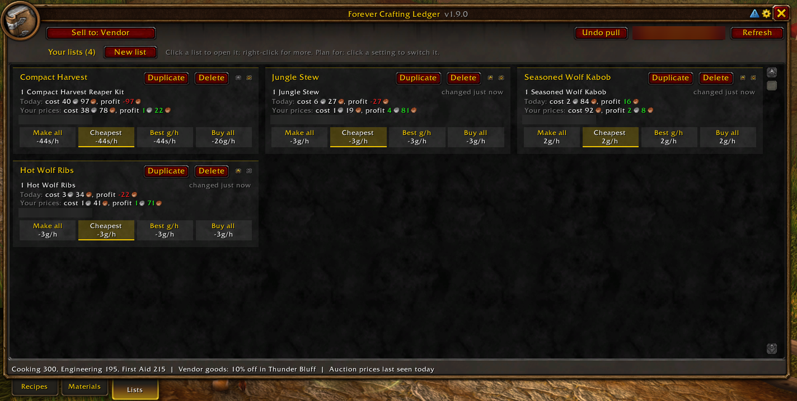
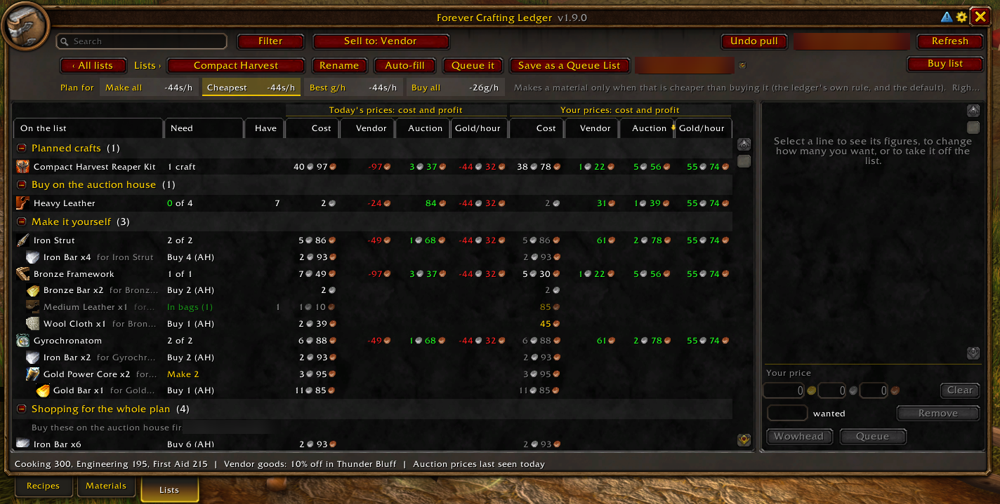

# 🛠️ Forever Crafting Ledger

**Know what every recipe earns before you spend a copper.**

A <a href="https://github.com/TIMID-Group">TIMID Group</a> addon · Technological Integration and Managerial Innovation Department

[Features](#-key-features) · [Who it's for](#-who-its-for) · [How it works](#-how-it-works) · [Screenshots](#-screenshots) · [Works with](#-works-with) · [FAQ](#-faq) · [Get it](#-get-it)

## 💡 What it is

Is a recipe worth crafting? The answer depends on where each material is cheapest for you, what the result sells for, and how long the crafting takes. Forever Crafting Ledger works that out for every recipe of every profession, using vendor prices at your reputation, the auction house and the things you can make yourself. It keeps your shopping lists and your own prices too, so a plan goes from idea to shopping list in one window.

## ✨ Key features

- **Every recipe, priced.** See the cost of one craft and what it clears sold to a vendor or on the auction house, with each material taken from wherever it is cheapest for you.
- **Gold per hour.** Rank your recipes by what they earn in an hour of crafting, counting the time to make any materials on the way.
- **Your own prices.** Set what you mean to pay or sell for, and see your margins beside today's market figures.
- **Materials, the other way round.** Pick any material to see every way to get it, which recipe earns the most from it, and what it would fetch sold as it is.
- **Shopping lists.** Keep named lists of crafts and materials. Auto-fill adds what is worth buying, and a list breaks down all the way to ores, ending in one shopping total for the whole plan.
- **Plan by the hour.** A recipe shows what one hour of it makes and everything to buy for it, and a list can size a craft in hours as well as in counts.
- **Recipes you don't know yet.** See what you are ready to learn, what comes later, and how to learn each one, down to the vendor who sells it.
- **Plan for what matters to you (new in 1.9).** Each list is planned for Make all, Cheapest, Best gold per hour or Buy all, with all four compared side by side on the list's card.
- **Hand the plan to Forever Workbench.** Queue it sends a list's whole plan as groups, deepest materials first with a mail stage on top, and Workbench runs each group in rounds.

## 🎯 Who it's for

- **You want the best gold for your time.** Sort by Gold/hour and see which of your recipes pays most for an hour at the profession window.
- **You're sitting on a stack of a material.** The Materials tab shows whether a recipe turns it into more gold than selling it raw.
- **You're planning a big craft.** Put it on a list and see every bar, ore and vendor reagent it takes, net of what is already in your bags.
- **You buy below market.** Enter your own prices and see what your crafts really clear.
- **You use Forever Workbench.** Send the finished plan to its queue and let it run the buying and crafting in order.

## 🧭 How it works

1. **Get access and install** with WowUp, as described in [Get it](#-get-it). For auction prices, have Auctionator installed and let it scan the auction house once.
2. **Open the ledger** with `/fcl` or the book on the minimap.
3. **Find a winner.** On the Recipes tab, pick your professions and click a profit or Gold/hour heading to sort.
4. **Plan it.** Select a recipe for its full breakdown, then add it to a list. The Lists tab shows what to buy and where.

## 📸 Screenshots

Your lists as cards, each with its four Plan for figures (version 1.9).

One list broken down all the way, with today's prices and your own (version 1.9).

## 🔗 Works with

The ledger runs without any of these. Each one adds something when it is there.

- **[Forever Workbench](ForeverWorkbench.md)** (TIMID Group). Queue a recipe, or a list's whole plan in order, and use Workbench's measured crafting times for more accurate gold per hour.
- **Auctionator.** Auction prices and how old they are. Without it, only vendor goods have a price.
- **AtlasLoot.** Materials for recipes the game does not describe.
- **QuestieDB.** Who sells each item and where, and which creatures drop a recipe.
- **TomTom.** An arrow to a vendor you click in the ledger.
- **Every TIMID addon.** With two or more installed, their minimap buttons fold into one TIMID button, and the TIMID Group window shows them all in one place.

## ❓ FAQ

### Does it need other addons?

No, though Auctionator is strongly recommended. Without it the ledger can price only what vendors sell.

### Will it slow my game?

The ledger scans nothing itself. It reads the prices Auctionator has already collected and does its sums in its own window.

### Does it ever act on its own?

No. It never buys, sells, crafts or scans. Queue it only places steps on Forever Workbench's queue, and nothing runs until you press Start there.

### Is my data private?

Yes. Your lists, prices and settings stay on your computer. A problem report holds nothing about your character, realm, guild, gold or account, and it leaves the game only when you copy and paste it yourself.

### How do I report a problem?

Click the small red exclamation beside the gear on the ledger window, copy the link and paste it into your browser. The form opens already filled in. You can also use the [report form](https://github.com/TIMID-Group/WoW-Forever-Addons/issues/new?template=bug_report.yml) on the hub, open to everyone, invited or not.

## 📦 Get it

Forever Crafting Ledger is **invite only**.

1. **[Request access](https://github.com/TIMID-Group/WoW-Forever-Addons/issues/new?template=request_access.yml)**, tick Forever Crafting Ledger and submit.
2. **Accept the invite** from your email or the banner on GitHub.
3. **Install with WowUp**, following the hub's [Install](https://github.com/TIMID-Group/WoW-Forever-Addons#-install) steps. WowUp then shows every update.

Access opens the addon's own repo, with its full guide, every release and its issues.

*Figures audited by the Department. Profits remain the responsibility of the crafter.*

---

<b><a href="https://github.com/TIMID-Group">TIMID Group</a></b> · Technological Integration and Managerial Innovation Department Connected systems. Better builds.

