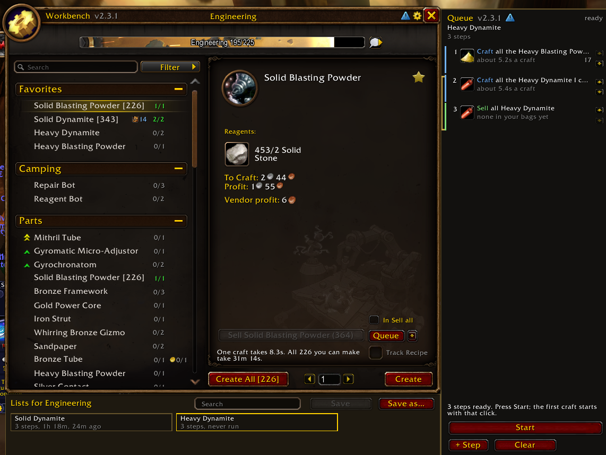
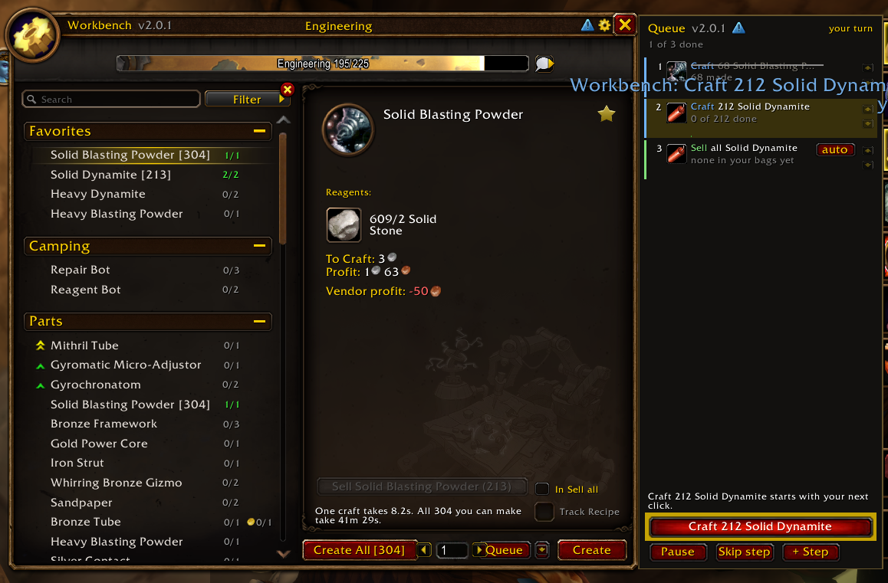

# 🛠️ Forever Workbench

**Your profession window, with buying, selling and a crafting queue built in.**

A <a href="https://github.com/TIMID-Group">TIMID Group</a> addon · Technological Integration and Managerial Innovation Department

[Features](#-key-features) · [Who it's for](#-who-its-for) · [How it works](#-how-it-works) · [Screenshots](#-screenshots) · [Works with](#-works-with) · [FAQ](#-faq) · [Get it](#-get-it)

## 💡 What it is

Crafting in bulk means a lot of small chores: counting materials, walking to a vendor, buying the right amount, keeping bag space, clicking Create again and again, then selling the results. Forever Workbench takes care of those chores inside the game's own profession window. You still craft with the game's buttons, and Workbench handles the counting, buying, selling and order of work around them.

## ✨ Key features

- **Marks on every recipe.** Three small columns show what is in your bags, your main materials and your vendor reagents, in green, yellow or grey, so you see what you can make without clicking.
- **Buy mats in one press.** Workbench works out what the selected recipe is short of and buys the vendor part, always stopping before your bags get too full or your gold drops below the reserve you set.
- **Sell what you crafted.** Sell one item or everything you have marked to sell, with a double-click guard and a warning before a sale too big for the vendor's buyback tab.
- **A crafting queue.** Line up Buy, Craft and Sell steps on a card beside the profession window. One click adds the whole chain for a recipe, and a chain too big for your bags runs in rounds that fit.
- **A plan check before you start.** See the time, the money in and out, your tightest bag moment and any problems, plus tips on materials that are cheaper elsewhere or already in your bank.
- **Queue Lists.** Save a queue under a name and load it again in one click the next time you craft the same things.
- **Crafting alerts.** Optional sounds and on-screen messages when a long run is almost done or finished, and a warning before the game's idle logout cuts a long Create All short.
- **Trophies.** Optional totals, records and 140 achievements for your crafting, counted from the day you turn them on.

## 🎯 Who it's for

- **You're levelling a profession** and need hundreds of crafts. Queue the whole Buy, Craft, Sell chain and give one click per craft run.
- **You craft for vendor gold.** The recipe pane shows what one craft clears at a vendor, and Sell all crafted empties your bags of everything you marked.
- **Your bags are always full.** Buying leaves the free slots you ask for, and a big queue splits itself into rounds that fit.
- **You step away during a long Create All.** An alert tells you when it is nearly done, and another warns you before the game would log you out.
- **You craft the same batch every week.** Save it as a Queue List and load it in one click.

## 🧭 How it works

1. **Get access and install** with WowUp, as described in [Get it](#-get-it).
2. **Open a profession.** Marks appear on every recipe straight away. Click the profession icon at the top left for the Workbench strip with Buy and Sell.
3. **Pick a recipe and buy.** Set how many crafts you want and press Buy mats at a vendor. Craft with the game's own Create buttons, as always.
4. **Try the queue.** Turn on the crafting queue in the settings, press Queue on a recipe, then Start. Each craft waits for your click on the glowing button, and the buying and selling at a vendor happen for you.

## 📸 Screenshots

The Queue card and Queue Lists (shown in version 2.3).

The queue waiting for your click (shown in version 2.0; newer versions look a little different).

## 🔗 Works with

All of these are optional. Workbench works on its own.

- **[Forever Crafting Ledger](ForeverCraftingLedger.md)** (TIMID Group). Profit figures, which crafts to sell or keep, buying for a whole shopping list, and a list's full plan sent to the queue in the right order.
- **Auctionator.** Auction prices in the Create button's tooltip, a Deep search at the auction house, and auction house tips in the plan check.
- **Every TIMID addon.** With two or more installed, their minimap buttons fold into one TIMID button, and the TIMID Group window shows them all in one place.

## ❓ FAQ

### Does it need other addons?

No. Everything it needs comes inside it. Forever Crafting Ledger and Auctionator add extra figures when you have them.

### Will it slow my game?

It adds to windows the game already has. Its heaviest work, the plan check, runs only when you edit the queue, open a vendor or press Start.

### Does it ever act on its own?

It never crafts by itself. The game only lets a craft start from your own click, and Workbench respects that. Buying and selling happen only when you press a button, or when a queue you started reaches a Buy or Sell step at a vendor. Automatic buying is off until you turn it on, and the queue never sells an item you marked Keep.

### Is my data private?

Yes. Your settings, queue lists and trophies stay on your computer. A problem report holds nothing about your character, realm, guild, gold or account, and it leaves the game only when you copy and paste it yourself.

### How do I report a problem?

Click the small red exclamation beside the gear on the profession window, copy the link and paste it into your browser. The form opens already filled in. You can also use the [report form](https://github.com/TIMID-Group/WoW-Forever-Addons/issues/new?template=bug_report.yml) on the hub, open to everyone, invited or not.

## 📦 Get it

Forever Workbench is **invite only**.

1. **[Request access](https://github.com/TIMID-Group/WoW-Forever-Addons/issues/new?template=request_access.yml)**, tick Forever Workbench and submit.
2. **Accept the invite** from your email or the banner on GitHub.
3. **Install with WowUp**, following the hub's [Install](https://github.com/TIMID-Group/WoW-Forever-Addons#-install) steps. WowUp then shows every update.

Access opens the addon's own repo, with its full guide, every release and its issues.

*The Department thanks you for your continued productivity.*

---

<b><a href="https://github.com/TIMID-Group">TIMID Group</a></b> · Technological Integration and Managerial Innovation Department Connected systems. Better builds.

